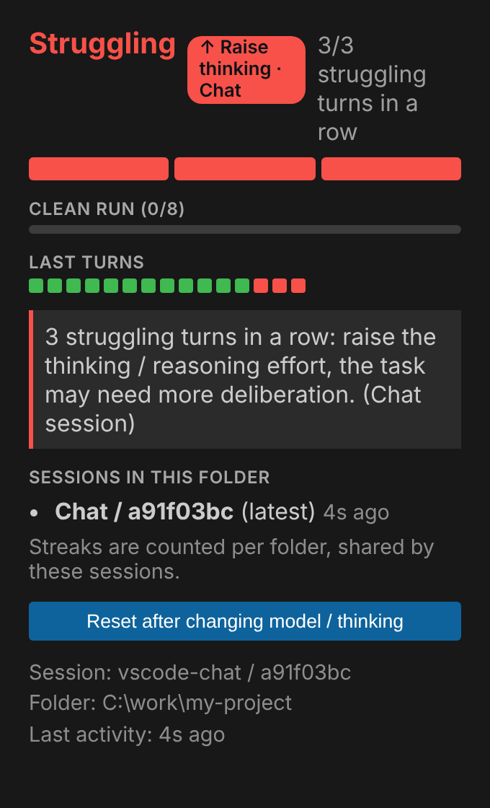
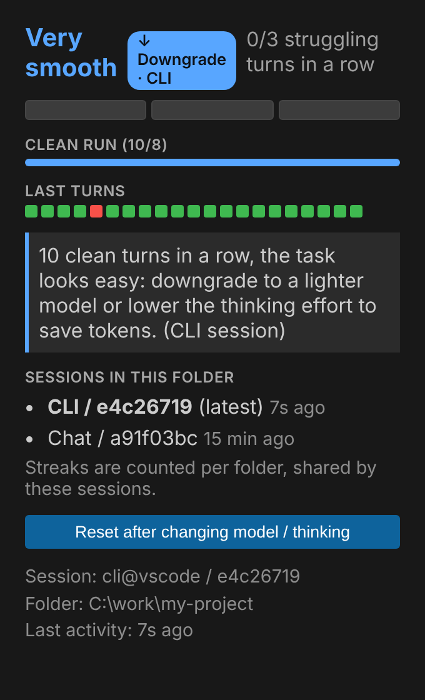

# Copilot Effort Guard

**Vedi a colpo d'occhio quanto sta faticando il modello di GitHub Copilot, e cosa fare: alzare il thinking, passare a un modello più potente o scendere a uno più leggero.**

Gli hook di [copilot-effort-guard](https://github.com/stefanochieli/copilot-effort-guard#readme) osservano i turni dell'agente Copilot (tool falliti, test che non passano, stesso comando fallito due volte). Gli hook non possono disegnare nulla in VS Code: questa estensione legge il loro stato e lo mostra in una barra colorata, in un pannello laterale e in notifiche.

| Il pannello a soglia raggiunta | Il pannello dopo molti turni puliti |
|---|---|
|  |  |

## Cosa vedi

**Nella status bar**: `▰▱▱ 1/3` è una barra a segmenti, qui 1 turno faticoso di fila su una soglia di 3. Il colore cambia con lo stato:

| Stato | Aspetto | Cosa significa |
|---|---|---|
| Tutto ok | testo verde | nessuna fatica |
| Qualche fatica | sfondo giallo | almeno un turno faticoso |
| Soglia raggiunta | sfondo rosso | **alza il thinking / reasoning** |
| Il doppio della soglia | sfondo rosso | più thinking non è bastato: **passa a un modello più potente** |
| Molti turni puliti (default 8) | testo blu con ✓ | il task sembra facile: **scendi a un modello più leggero** o riduci il reasoning per risparmiare token |
| `effort -` | grigio | nessun dato per la cartella aperta |

**Nel pannello laterale** (icona *Effort Guard* nell'Activity Bar, o clic sulla voce di stato): barra grande colorata, avanzamento verso la serie di turni puliti, cronologia degli ultimi turni (verde pulito, rosso faticoso), suggerimento con un'etichetta sull'azione (*↑ Raise thinking*, *↑↑ Upgrade model*, *↓ Downgrade*), sessioni recenti e ultima attività.

**Nelle notifiche**: un avviso quando la serie raggiunge la soglia, uno al doppio e uno quando il task sembra facile, sempre con l'azione consigliata.

## Dopo aver cambiato modello o thinking

Premi **Reset** in fondo al pannello (o il comando *Effort Guard: Reset after changing model or thinking*): le serie ripartono da zero e la valutazione riguarda il nuovo modello. Gli hook non vedono il cambio di modello, quindi senza reset la serie continua a contare.

## Sessioni: chat e CLI

Funziona con la chat agente di VS Code e con la Copilot CLI lanciata nel terminale integrato (o in una sua sottocartella). Il consiglio indica da quale sessione viene (`CLI` o `Chat`) e il pannello elenca le sessioni recenti. Le serie sono contate **per cartella** e condivise dalle sessioni di quella cartella: l'estensione non sa quale modello stai usando, osserva soltanto come vanno i turni.

## Requisiti

Gli hook vanno installati una volta per utente, prima dell'estensione:

```
git clone https://github.com/stefanochieli/copilot-effort-guard
node copilot-effort-guard/scripts/install.mjs --user
```

Dettagli in [SETUP](https://github.com/stefanochieli/copilot-effort-guard/blob/main/docs/SETUP.md). Serve Node.js 20 o superiore per gli hook.

## Installazione dell'estensione

Dal Marketplace: cerca *Copilot Effort Guard* nelle estensioni, oppure

```
code --install-extension stefanochieli.copilot-effort-guard-status
```

Si aggiorna da sola. In alternativa il `.vsix` allegato a ogni [GitHub Release](https://github.com/stefanochieli/copilot-effort-guard/releases) (*Extensions → … → Install from VSIX…*) o la build da sorgente:

```
cd vscode-extension
npx --yes @vscode/vsce package --no-dependencies --skip-license
code --install-extension copilot-effort-guard-status-<versione>.vsix --force
```

Se `code` non è nel PATH (Windows), usa `%LOCALAPPDATA%\Programs\Microsoft VS Code\bin\code.cmd`. Poi ricarica la finestra (*Developer: Reload Window*).

## Impostazioni

| Impostazione | Default | Effetto |
|---|---|---|
| `effortGuard.copilotHome` | vuoto | Cartella che contiene `effort-guard/` (vuoto: `COPILOT_HOME` o `~/.copilot`) |
| `effortGuard.threshold` | 3 | Soglia di riserva: di norma si usa quella registrata dagli hook (`EFFORT_GUARD_THRESHOLD`) |
| `effortGuard.notify` | true | Mostra le notifiche |

La soglia dei turni puliti si cambia con la variabile d'ambiente `EFFORT_GUARD_CALM` (default 8), letta dagli hook.

## Se qualcosa non va

- Resta `effort -` dopo aver usato Copilot: lancia `node ~/.copilot/effort-guard/effort-guard.mjs doctor` per controllare che gli hook girino.
- Il comando *Effort Guard: Show report* stampa il riepilogo di tutti i progetti nel pannello *Output → Effort Guard*.
- L'indicatore si aggiorna ogni 2 secondi.

Esiste anche un plugin per gli IDE JetBrains (IntelliJ IDEA e simili): vedi [`intellij-plugin/`](https://github.com/stefanochieli/copilot-effort-guard/tree/main/intellij-plugin).
